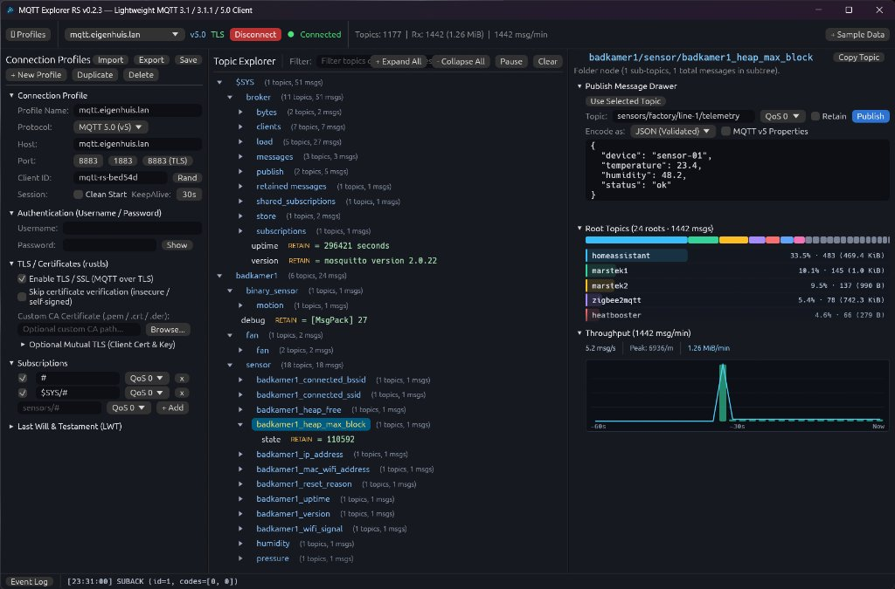

<div align="center">
  
  <h1>MQTT Explorer RS (<code>mqtt-client</code>)</h1>
  <p>A lightweight, portable, single-binary desktop MQTT client written in pure Rust using <code>eframe</code> / <code>egui</code>, <code>tokio</code>, and <code>rustls</code>.</p>
</div>

## Screenshot



## Features

- **Full Protocol Support (MQTT 3.1 to 5.0)**:
  - **MQTT 3.1** (`MQIsdp`, protocol level `3`)
  - **MQTT 3.1.1** (`MQTT`, protocol level `4`)
  - **MQTT 5.0** (`MQTT`, protocol level `5`) including full v5 properties support:
    - `User Properties` (arbitrary key-value pairs)
    - `Message Expiry Interval`
    - `Content Type`
    - `Response Topic` & `Correlation Data`
    - `Payload Format Indicator` & `Topic Alias`
- **Pure-Rust TLS 1.2 & 1.3 (`rustls` + `rustls-rustcrypto`)**:
  - Zero OpenSSL or C compiler dependency for cryptography
  - Built-in Mozilla WebPKI roots + OS native certificate store
  - Custom CA certificate file picker (`.pem`, `.crt`, `.cer`, `.der`)
  - **"Skip certificate verification (insecure / self-signed)"** toggle for local development and self-signed brokers
  - Optional Mutual TLS (mTLS) Client Certificate & Private Key support
- **Authentication & Session Management**:
  - Username & Password authentication
  - Configurable Client ID, Clean Start / Session, Keep-Alive interval, and Last Will & Testament (LWT)
  - Saved Connection Profiles stored in portable `mqtt_profiles.toml` with one-click TOML/JSON Import & Export
- **MQTT Explorer-Style GUI**:
  - **Hierarchical Collapsible Topic Tree** with live inline value previews, sub-topic/message counters, `RETAIN` badges, recent-update indicators, and real-time search/filter
  - **Payload Inspector & Syntax Highlighting**:
    - Auto-detection and manual toggle between **JSON** (pretty-printed & syntax-highlighted), **UTF-8 Text**, **Hex Dump** (canonical offset + hex + ASCII), **Base64**, **MessagePack** (binary decoded to structured JSON), and **Protobuf Wire Format** (schema-less recursive wire unpacker)
  - **Message History & Diff View**:
    - Per-topic message ring buffer with historical version selector
    - Unified colored line-by-line **Diff View** comparing the current payload against previous messages
    - **Value History Chart / Sparkline** for numeric telemetry topics
  - **Publish Drawer**:
    - Publish with QoS 0/1/2, Retain flag, and MQTT v5 Properties (`Content-Type`, `Response-Topic`, `Correlation-Data`, `Message-Expiry-Interval`, `User Properties`)
    - Encode outgoing payloads from Raw UTF-8, Validated JSON, Hex string, Base64, `JSON -> MessagePack (Binary)`, or `JSON -> Protobuf Wire (Binary)`

---

## Building Locally

```bash
cargo build --release
```

The single-file executable is produced at:
- **Linux / macOS**: `target/release/mqtt-client`
- **Windows**: `target/release/mqtt-client.exe`

---

## Cross-Platform Targets (`amd64` & `arm64`)

This project uses pure-Rust networking and TLS (`rustls` + `rustls-rustcrypto`), enabling clean cross-compilation across all 6 major desktop targets:

| OS | Architecture | Rust Target Triple |
|---|---|---|
| **Linux** | `amd64` (`x86_64`) | `x86_64-unknown-linux-gnu` |
| **Linux** | `arm64` (`aarch64`) | `aarch64-unknown-linux-gnu` |
| **macOS** | `amd64` (Intel) | `x86_64-apple-darwin` |
| **macOS** | `arm64` (Apple Silicon) | `aarch64-apple-darwin` |
| **Windows** | `amd64` (`x86_64`) | `x86_64-pc-windows-msvc` / `x86_64-pc-windows-gnu` |
| **Windows** | `arm64` (`aarch64`) | `aarch64-pc-windows-msvc` / `aarch64-pc-windows-gnullvm` |

Automated multi-arch builds are configured in [`.github/workflows/release.yml`](.github/workflows/release.yml).
